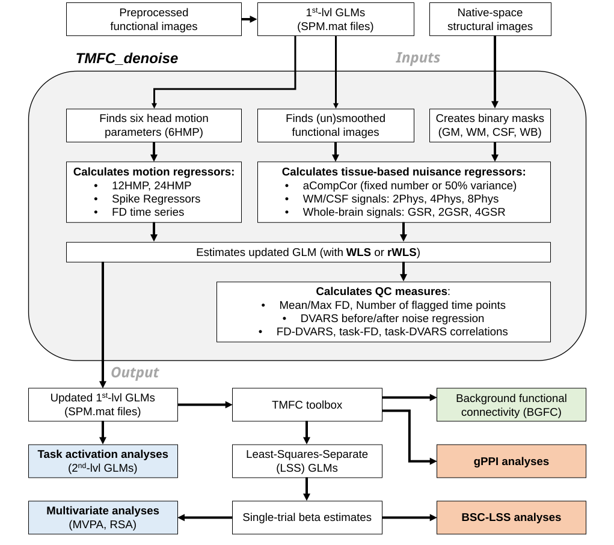

.. _overview:

Overview
========

**TMFC_denoise** provides both a graphical user interface (GUI) and command-line functionality. 
To open the GUI, run the ``TMFC_denoise.m`` function in MATLAB.

**TMFC_denoise** generates nuisance regressors, calculates quality control (QC) measures, 
and estimates updated GLMs using weighted least-squares (WLS) or robust WLS (rWLS). 

   TMFC_denoise overview.

Saving and Loading Analysis Setups
----------------------------------

When ``TMFC_denoise`` is launched without input arguments, the startup dialog offers two options: **New analysis** and **Load saved analysis**.

**New analysis**

The user first selects a folder for automatic setup saves, then proceeds with selecting subjects, SPM.mat files, and denoising options. A new timestamped ``TMFC_denoise_autosave_*.mat`` file is created for each run and automatically updated after key setup steps. These autosaves allow users to restore their analysis configuration if the setup process is interrupted.

**Load saved analysis**

The user selects a previously saved setup file (either an autosave or a manually saved project). The toolbox restores the selected files and denoising settings, allowing the user to modify the analysis without selecting all input files again. Structural and functional image paths are reused if they remain valid. New autosaves are created in the same folder as the loaded setup, without overwriting the original file.

**Manual saving**

After the analysis is completed, the user can save the setup under a custom filename and in any folder. If manual saving is skipped, the automatic setup file remains available.

.. note::

   Setup files contain file paths and analysis parameters, not neuroimaging data or analysis results. The referenced input files must remain accessible. This workflow applies only to GUI launches without input arguments; command-line usage remains unchanged.

Inputs
------

Inputs include structural images in native space and preprocessed functional images, 
together with first-level GLMs specified in SPM. 

Users specify paths to first-level GLMs (``SPM.mat`` files), select denoising options, 
and set masking parameters. First-level GLMs must be **specified and estimated** in SPM12 or SPM25 and 
**must include six head motion regressors**. 

Structural images in native space and preprocessed functional images can be automatically identified through the GUI. 
Functional images may be preprocessed using an SPM-based pipeline 
(e.g., see the ``preproc_fmri.m`` function in ``/spm/batches/``; Penny et al., 2011) 
or with alternative pipelines such as fMRIPrep (Esteban et al., 2019). 
Preprocessing should include **realignment** and **normalization**, whereas **slice-time correction** and **smoothing** are optional. 

Denoising Options
-----------------

1) Head motion expansions
2) Framewise displacement (FD) and task-FD correlations
3) Spike regressors
4) aCompCor regressors 
5) WM/CSF regressors
6) Global signal regressors (GSR)
7) DVARS (Derivative of root mean square VARiance over voxelS), FD-DVARS correlations, and task-DVARS correlations
8) Robust weighted least squares (rWLS)

Outputs
-------

All outputs, including noise regressors, updated GLMs, and QC measures, 
are saved in a ``TMFC_denoise`` subfolder within each subject’s first-level GLM directory. 
Group-level QC measures can be saved as a single ``.mat`` file in a user-specified directory.
The report can also be saved as a .txt file and used to facilitate reporting of denoising procedures.

How to Use Updated GLMs
-----------------------

1. Updated GLMs can be used for **task-based activation analyses**. 

2. Updated GLMs can be used as **input to the TMFC toolbox**, which implements:

- **Background functional connectivity (BGFC)**
- **Least-squares-separate (LSS) GLMs**
- **Beta-series correlation (BSC-LSS)** and **beta scrubbing**
- **gPPI with deconvolution**

3. The **TMFC toolbox** can also generate denoised **volume of interest (VOI)** files 
for **dynamic causal modelling (DCM)**. **Note:** The original model should be prepared for DCM analysis. 
Both **TMFC_denoise** and the **TMFC toolbox** support ``SPM.mat`` files with concatenated sessions (i.e. ``spm_fmri_concatenate.m``). 

4. Denoised **single-trial beta estimates** (outputs of LSS GLMs) can also be used for **multivariate approaches**, 
including **multivoxel pattern analysis (MVPA)** and **representational similarity analysis (RSA)**.

